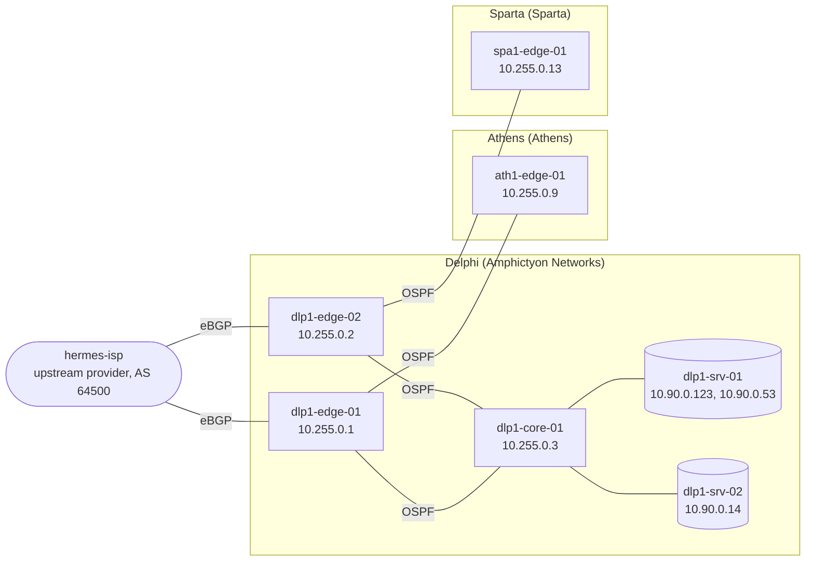
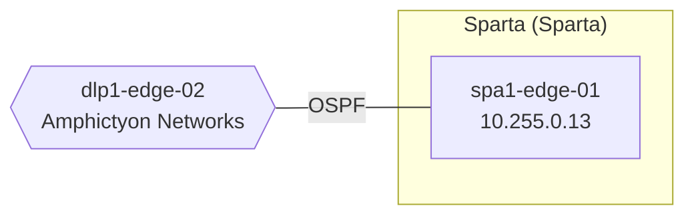

<!-- Generated by demo-gen from spec/basic.yaml. Do not edit; edit the spec. -->

# Lab topology

The lab is its own Compose project, `hegemony-lab`, started before the platform.
The platform's api, worker, scheduler and sandbox join its management network,
`hegemony-lab-mgmt` (`172.28.103.0/24`); nothing else connects the two.

Inside, the operator's routers (AS 65010) run OSPF with each other and the
tenants' routers, and the two edges peer over eBGP with the upstream provider
(AS 64500). The edges announce the loopbacks, the services LAN
(`10.90.0.0/24`) and anything in `10.255.100.0/24` upstream.

## What Athens sees

## What Sparta sees

## Containers

| Container | Organization | Management | Loopback | Login |
| --- | --- | --- | --- | --- |
| `hermes-isp` | none (upstream) | `172.28.103.28` | `198.51.100.1` | `netops` |
| `dlp1-edge-01` | Amphictyon Networks | `172.28.103.21` | `10.255.0.1` | `netops` |
| `dlp1-edge-02` | Amphictyon Networks | `172.28.103.22` | `10.255.0.2` | `netops` |
| `dlp1-core-01` | Amphictyon Networks | `172.28.103.23` | `10.255.0.3` | `netops` |
| `ath1-edge-01` | Athens | `172.28.103.24` | `10.255.0.9` | `netops` |
| `spa1-edge-01` | Sparta | `172.28.103.25` | `10.255.0.13` | `netops` |
| `dlp1-srv-01` | Amphictyon Networks | `172.28.103.26` | `10.90.0.123, 10.90.0.53` | `netops` |
| `dlp1-srv-02` | Amphictyon Networks | `172.28.103.27` | `10.90.0.14` | `netops` |

## Links

| Link | Network | Ends | Protocol |
| --- | --- | --- | --- |
| `link-01` | `10.255.1.0/29` | `hermes-isp` (10.255.1.2), `dlp1-edge-01` (10.255.1.3) | eBGP |
| `link-02` | `10.255.1.8/29` | `hermes-isp` (10.255.1.10), `dlp1-edge-02` (10.255.1.11) | eBGP |
| `link-03` | `10.255.1.16/29` | `dlp1-edge-01` (10.255.1.18), `dlp1-core-01` (10.255.1.19) | OSPF |
| `link-04` | `10.255.1.24/29` | `dlp1-edge-02` (10.255.1.26), `dlp1-core-01` (10.255.1.27) | OSPF |
| `link-05` | `10.255.1.32/29` | `dlp1-edge-01` (10.255.1.34), `ath1-edge-01` (10.255.1.35) | OSPF |
| `link-06` | `10.255.1.40/29` | `dlp1-edge-02` (10.255.1.42), `spa1-edge-01` (10.255.1.43) | OSPF |

## Around the network

- **Gitea**, <http://localhost:3000>: `netops/inventory` holds the
  planned sites the Git inventory provider reads, and
  `netops/config-backups` the routers' configuration backups.
- **Mailpit**, <http://localhost:8025>: every mail the demo sends.
